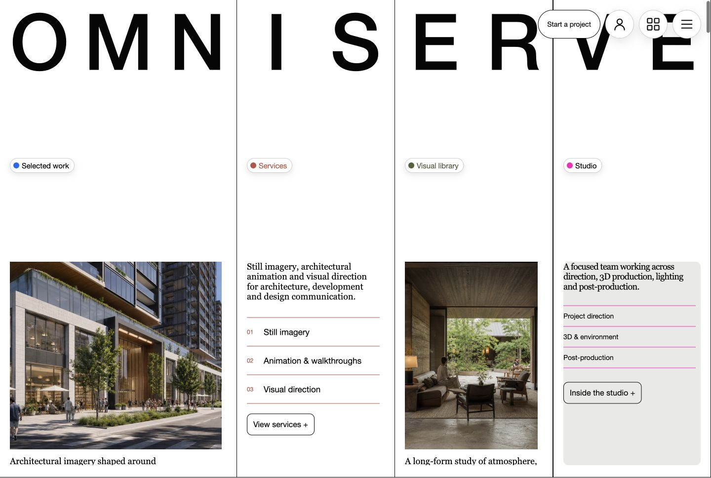
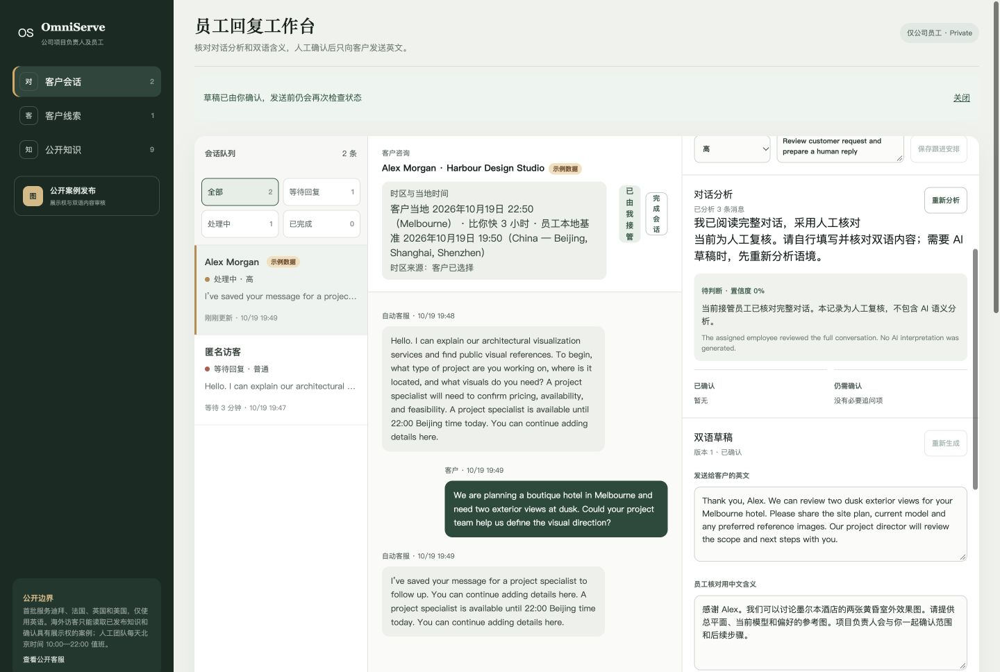
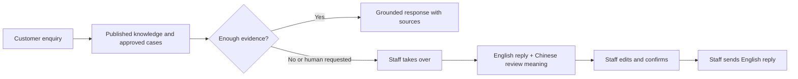
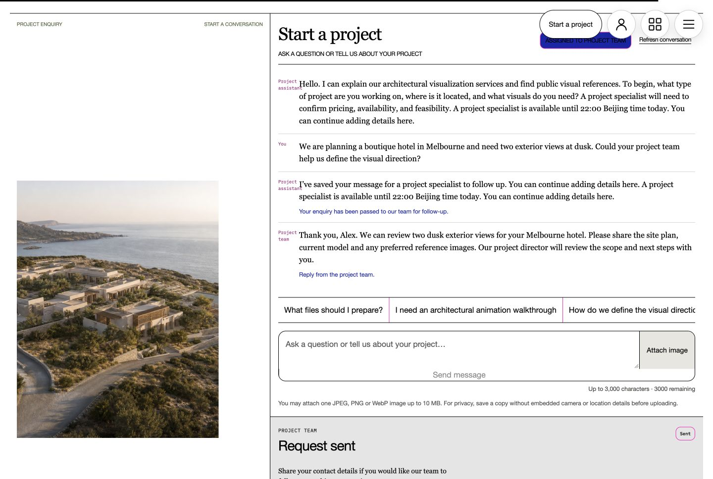
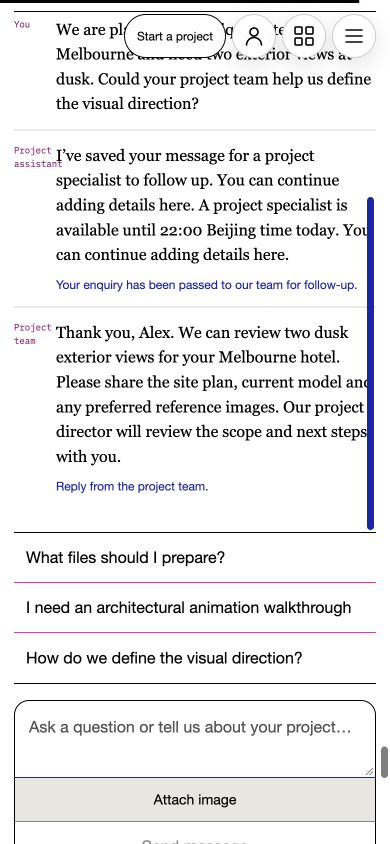

# OmniServe

**From a project question to a reviewed reply—without losing the human in the loop.**

Customers get a clear place to ask about architectural-visualization work, share a reference image, and request a follow-up. Project staff get the same conversation context, practical handoff tools, and a bilingual reply workflow they control.

[中文](README.md) · [English](README.en.md)



*Example conversation and interface only. No real customer data or commissioned project is shown.*

## What it does

### For customers

- Ask about architectural stills, animation, visual direction, and post-production in one persistent conversation.
- Share one JPEG, PNG, or WebP reference image per message (up to 10 MB).
- See answers grounded in published project knowledge, with source references where available.
- Request a human follow-up and choose from 50 common city-based time-zone options, or enter another valid IANA time zone. The browser’s time-zone suggestion is editable and is not precise location data.

### For project staff

- Take over an enquiry with its messages, attachments, and context in one workspace.
- Review the customer’s local date and time alongside your own time zone.
- Prepare or manually write an English reply with a Chinese review meaning; revise either side, confirm the current version, then send the English reply.
- Track lead status, priority, next action, and notes; complete or reopen a conversation and reassign it when permitted.



*Example staff review using fictional QA data. It does not depict a real customer or project.*

## A human-controlled workflow



AI features are **disabled by default**. The full enquiry, handoff, manual bilingual drafting, confirmation, and send flow remains available without model configuration. With a configured model, the public assistant can answer from published knowledge. After human takeover, AI-assisted replies remain drafts until the authorized employee confirms and sends them. See the operations guide for model integration details.

The assistant can retrieve only currently published knowledge and cases approved for public display. It does not quote prices, confirm schedules or delivery quality, or approve legal or contract terms. Questions needing more evidence or human judgment can be handed to the project team.



*Illustrative conversation and reply. No real customer exchange is shown.*



*Mobile interface example with fictional enquiry content.*

## Privacy and project boundaries

Automated assistance may process messages and images to help prepare a response. Contact details are requested only when a customer asks for follow-up and gives explicit consent. Conversation access expires after seven days; expired records are removed later through routine cleanup. See the [privacy notice](app/privacy/page.tsx) for details.

The visual work shown in this repository is concept visualization, not a claim of client commission or delivery. This repository is a sanitized reconstruction of an overseas customer-support workflow. See [media sources and usage notes](docs/MEDIA.md).

## Run locally

Requires Node.js 22.13 or newer.

```bash
git clone https://github.com/Irixil/OmniServe.git
cd OmniServe
npm ci
cp .dev.vars.example .dev.vars
npm run dev -- --host localhost --port 3000
```

Keep real credentials in a protected local secret store. Do not commit `.dev.vars` or provider keys. Model and image-analysis switches in the example configuration are off by default.

A clean installation from the public npm registry with an empty npm user configuration has passed. For setup detail and operational configuration, see [Operations](docs/OPERATIONS.md); for the exact local verification scope and what remains untested, see [Verification](docs/VERIFICATION.md).

## Built with

Next.js, React, TypeScript, Vinext, Cloudflare’s Vite integration, D1/R2-compatible storage interfaces, and Orama retrieval. Knowledge search uses lexical retrieval and can combine it with vector similarity when embeddings are configured.
