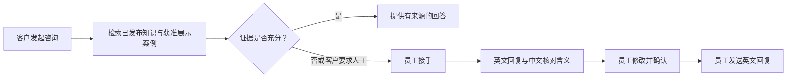

# OmniServe

**让建筑可视化项目咨询顺畅走到人工确认的回复。**

客户可以直接了解服务、描述项目、分享参考图片并请求团队跟进。项目团队则能在同一会话中接手、核对双语回复并决定何时发送。

[中文](README.md) · [English](README.en.md)


*界面与咨询内容为场景示例，不含真实客户资料，也不代表真实客户委托。*

## 客户与团队各自得到什么

### 面向客户

- 在一个持续会话中询问建筑效果图、动画漫游、视觉方向和后期制作。
- 每条消息可附一张 JPEG、PNG 或 WebP 参考图，最大 10 MB。
- 获取基于已发布知识的回答；适用时可查看回答来源。
- 自愿请求团队跟进，并从 50 个常用城市时区中选择，或填写其他有效 IANA 时区。浏览器时区建议可以修改，不代表精确位置。

### 面向项目团队

- 接手咨询时查看完整对话、附件与上下文。
- 同时查看客户当地日期和时间，以及员工浏览器时区。
- 创建或手工撰写英文回复，并提供中文核对含义；修改后生成新版本，由授权员工确认后发送英文。
- 管理线索状态、优先级、下一步和备注；按权限完成、重开或重新分配会话。


*员工工作台场景示例，使用虚构的验收数据，不代表真实客户或真实项目。*

## 由团队掌握的回复流程



AI 功能**默认关闭**。即使不配置模型，咨询、人工接管、双语草稿手工撰写、确认和发送流程仍可使用。配置有效的服务端模型后，公开助手可依据已发布知识回答；员工接管后的 AI 回复始终作为草稿，由员工核对确认后发送。模型接入说明见运行文档。

公开回答只使用当前已发布的知识和获准公开展示的案例。助手不会报价、确认档期或交付质量，也不会批准法律或合同条件。证据不足或需要人工判断的问题可以转交项目团队。


*会话和回复为示例场景，不含真实客户对话。*


*移动端界面与咨询内容为虚构示例。*

## 隐私与项目边界

自动化辅助可能处理客户消息和图片以准备回复。只有客户主动请求跟进并明确同意后，才会收集其提交的联系资料。会话访问权限在七天后失效；过期记录会在后续例行清理中移除。详见[隐私说明](app/privacy/page.tsx)。

仓库中的视觉作品属于概念视觉研究，不代表真实客户委托或交付。本仓库是海外客服流程的脱敏重建代码。图片来源与使用说明见 [MEDIA.md](docs/MEDIA.md)。

## 本地运行

需要 Node.js 22.13 或更高版本。

```bash
git clone https://github.com/Irixil/OmniServe.git
cd OmniServe
npm ci
cp .dev.vars.example .dev.vars
npm run dev -- --host localhost --port 3000
```

请在受保护的本地密钥存储中配置真实凭证，不要提交 `.dev.vars` 或服务商密钥。示例配置中的模型和图片分析开关默认关闭。

已使用官方公开 npm 仓库和空用户配置完成干净安装。配置与运行说明见 [OPERATIONS.md](docs/OPERATIONS.md)；本地验收范围及尚未验证的事项见 [VERIFICATION.md](docs/VERIFICATION.md)。

## 技术构成

Next.js、React、TypeScript、Vinext、Cloudflare Vite 集成、D1/R2 兼容存储接口与 Orama。知识检索使用词法搜索；配置 embedding 后可结合向量相似度。
