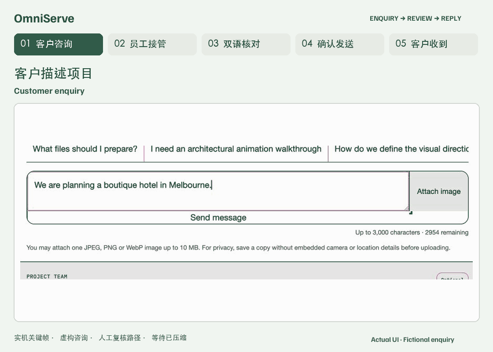

# OmniServe

**建筑可视化团队的海外 AI 客服与双语回复工作台。**

客户发起咨询、分享参考图并请求跟进；员工接手同一会话，修改双语草稿，确认后发送英文回复。

[中文](README.md) · [English](README.en.md) · [本地运行](#本地运行)



*虚构咨询的实际界面关键帧；展示人工复核路径，等待已压缩；AI 默认关闭。*

**客户咨询 → 员工接管 → 双语草稿 → 确认并发送英文 → 客户收到回复**

- **上下文跟随交接：** 员工接手时可查看客户消息、附件与咨询上下文。
- **确认后才发送：** 员工修改英文回复和中文核对含义；只有经授权员工确认的英文版本才能发送。
- **跨时区跟进：** 提供 50 个常用城市时区选项，并可填写其他有效 IANA 时区；浏览器建议可编辑，不代表精确位置。

## 客户与团队能做什么

### 客户咨询

- 通过持续会话了解建筑效果图、动画漫游、视觉方向和后期制作。
- 每条消息可附一张 JPEG、PNG 或 WebP 参考图片，最大 10 MB。
- 在模型启用时，公开助手可依据当前已发布知识回答，并在适用时展示来源；客户也可请求员工跟进。
- 自愿请求跟进时可提交联系资料并明确同意；不提交联系资料也可以咨询。

### 员工跟进

- 接手会话，查看原始消息、附件、线索摘要和客户当地日期时间。
- 生成或手工撰写英文回复及中文核对含义，修改后保存为新版本。
- 检查并确认当前草稿后发送英文；系统不会自动发送回复。
- 更新线索状态、优先级、下一步与备注；按权限完成、重开或重新分配会话。

### 知识与 AI 边界

公开助手的检索范围限于当前已发布的知识与获准公开展示的案例。证据不足、客户要求人工或需要商业判断时，咨询可交由员工处理。系统不会报价、确认档期或交付质量，也不会批准法律或合同条件。

AI 功能默认关闭。模型只有在运营者完成服务端配置并启用后才参与相应流程；没有模型配置时，客户咨询、人工接管、双语手工草稿、员工确认与发送仍可完整使用。启用 AI 后生成的员工回复仍是待审核草稿，必须由有权限的员工确认后发送。自动化辅助可能处理消息和图片以准备回复，详见[隐私说明](app/privacy/page.tsx)。

<details>
<summary>更多界面</summary>


*客户侧入口示例。*


*员工工作台示例，使用虚构的验收数据。*


*虚构咨询的回复示例。*


*390 × 844 视口的移动端示例；内容为虚构咨询。*

</details>

## 隐私与项目边界

只有客户主动请求跟进并明确同意后，才会收集其提交的联系资料。会话、图片及关联联系资料的访问权限在七天后失效；过期记录会在后续例行清理中移除。更多信息见[隐私说明](app/privacy/page.tsx)。

本仓库是海外客服流程的脱敏重建代码。仓库中的视觉作品属于概念视觉研究，不代表真实客户委托或交付；截图中的咨询与联系人均为虚构示例。详见[图片来源与使用说明](docs/MEDIA.md)。

## 本地运行

需要 Node.js 22.13 或更高版本。

```bash
git clone https://github.com/Irixil/OmniServe.git
cd OmniServe
npm ci
cp .dev.vars.example .dev.vars
npm run dev -- --host localhost --port 3000
```

请在受保护的本地密钥存储中配置真实凭证，不要提交 `.dev.vars` 或服务商密钥。示例配置中的模型和图片分析开关默认关闭。

已使用官方公开 npm 仓库和空用户配置完成干净安装。配置与运行说明见 [OPERATIONS.md](docs/OPERATIONS.md)；本地验收范围与尚未验证事项见 [VERIFICATION.md](docs/VERIFICATION.md)。

## 技术构成

Next.js、React、TypeScript、Vinext、Cloudflare Vite 集成、D1/R2 兼容存储接口与 Orama。知识检索使用词法搜索；配置 embedding 后可结合向量相似度。
